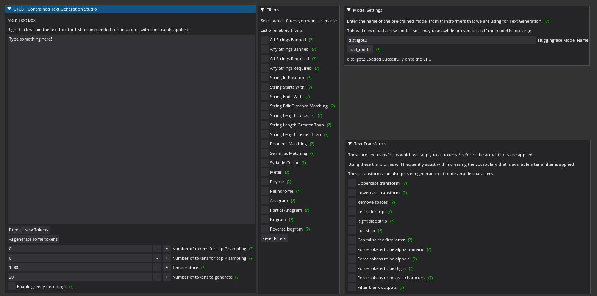

# Constrained Text Generation Studio (CTGS)

[](https://paperswithcode.com/sota/conditional-text-generation-on-lipogram-e?p=most-language-models-can-be-poets-too-an-ai)



## Table of Contents
* [Introduction](#introduction)
* [Features](#features)
* [Install Instructions](#install-instructions)
* [Usage Instructions](#usage-instructions)
* [Architecture](#architecture)

## Introduction

**Constrained Text Generation Studio** (CTGS) is an AI writing assistant for recreational linguists, poets, creative writers, and researchers to use and study the ability of **large language models to generate constrained text.**

CTGS allows users to generate or choose from text with any combination of a wide variety of constraints, such as banning a particular letter, forcing generated words to have a certain number of syllables, and/or forcing words to be partial anagrams of another word. A partial list of these sorts of constraints can be found [here](https://en.wikipedia.org/wiki/Constrained_writing#Description).

### How It Works

At each generation step, a language model samples from a probability distribution over its entire vocabulary. **CTGS filters or penalizes tokens that violate the chosen constraints before the sampling step.** This has two advantages over fine-tuning:

1. The model will **never** violate the imposed constraint (when using hard filtering), which is impossible to guarantee with fine-tuning alone.
2. On constrained writing datasets, this technique results in **strictly superior perplexity** over fine-tuning alone.

### Progressive Relaxation & Backtracking

Previous versions of CTGS suffered from a fundamental problem: when constraints were too strict, they would filter out all tokens from the top-k/top-p candidate pool, leaving the model with nothing to say. This **vocabulary crippling** problem has been solved with three mechanisms:

- **Progressive Relaxation**: When constraints filter out all candidates at the current top-k/top-p level, CTGS automatically expands the candidate pool (doubling k, loosening p) up to the full vocabulary. This ensures tokens are always available if any exist.
- **Soft Constraints**: Instead of hard pass/fail filtering, the Constraint Strength slider allows penalty-based constraints. At strength < 1.0, tokens that violate constraints receive reduced probability rather than being banned entirely. This preserves model coherence while nudging toward constraint satisfaction.
- **Backtracking**: During multi-token generation, if the model hits a dead end (no valid tokens), it backtracks to a previous decision point and tries an alternative token. This prevents generation from stalling.

### Paper

CTGS, along with its [datasets](https://huggingface.co/datasets/Hellisotherpeople/Lipogram-e) and a HuggingFace Space called [Gadsby](https://huggingface.co/spaces/Hellisotherpeople/Gadsby), are presented in the paper ["Most Language Models can be Poets too: An AI Writing Assistant and Constrained Text Generation Studio"](https://drive.google.com/file/d/1lTZX5_Ef0nsOXj7s1x_S7LPdgYvzcp-g/view), appearing at [The Second Workshop on When Creative AI Meets Conversational AI (CAI2)](https://sites.google.com/view/cai-workshop-2022), jointly held at [COLING 2022](https://coling2022.org/).

## Features

CTGS consists of 4 main components: the **model**, the **constraint engine**, the **filters**, and the **text transforms**.

### HuggingFace Integration

CTGS supports any causal language model available on [HuggingFace](https://huggingface.co/models?pipeline_tag=text-generation&sort=downloads), with support for 32-bit, 16-bit, and 8-bit precision loading.

### Constraint Engine

The constraint engine provides three settings that control how constraints interact with the language model:

- **Constraint Strength** (0.0 - 1.0): At 1.0, constraints are hard filters (tokens pass or fail). Below 1.0, tokens that fail constraints receive a probability penalty instead of being removed. This prevents vocabulary crippling while still guiding generation toward constraint satisfaction.
- **Progressive Relaxation**: When enabled, automatically expands the top-k/top-p candidate pool if too few tokens survive constraint filtering. Tries progressively larger pools before falling back to the full vocabulary.
- **Max Backtracks**: During multi-token generation, the number of times the system will backtrack to try alternative tokens when hitting dead ends.

### Filters

CTGS has 21 constraint filters organized into 4 categories. Any combination can be applied simultaneously:

**Lexical Constraints**
- **All Strings Banned** (Lipogram) - Avoid particular letters or strings
- **Any Strings Banned** (Weak Lipogram) - Avoid at least one of the specified letters/strings
- **All Strings Required** (Reverse Lipogram) - Force particular letters or strings to appear
- **Any Strings Required** (Weak Reverse Lipogram) - Force at least one of the specified strings
- **String In Position** - Force particular characters at specific positions
- **String Starts With** - Guarantee tokens start with a particular prefix
- **String Ends With** - Guarantee tokens end with a particular suffix
- **String Length Equal To** - Exact length constraint
- **String Length Greater Than** - Minimum length constraint
- **String Length Less Than** - Maximum length constraint

**Phonetic Constraints**
- **Phonetic Matching** - Match tokens phonetically using the Metaphone algorithm
- **Syllable Count** - Require a specific number of syllables
- **Meter** - Match the stress pattern (meter) of a given word
- **Rhyme** - Return tokens that rhyme with a given word

**Semantic Constraints**
- **Semantic Matching** - Find tokens semantically similar using FastText word vectors
- **String Edit Distance** - Find tokens within a Levenshtein distance threshold

**Structural Constraints**
- **Palindrome** - Tokens must read the same forwards and backwards
- **Anagram** - Tokens must be exact anagrams of a given string
- **Partial Anagram** - Tokens must be constructible from letters of a given string
- **Isogram** - No character may appear more than N times
- **Reverse Isogram** - Every character must appear at least N times

### Text Transforms

Text transforms are applied to tokens **before** constraint filtering. They increase the vocabulary that survives filtering:

- Uppercase / Lowercase / Capitalize first letter
- Remove spaces / Left strip / Right strip / Full strip
- Alphanumeric only / Alphabetic only / Digits only / ASCII only
- Filter blank outputs

## Install Instructions

### Requirements
- Python 3.10+
- CUDA-capable GPU recommended (CPU works but is slower)

### Setup (uv - recommended)

```bash
git clone https://github.com/Hellisotherpeople/Constrained-Text-Generation-Studio.git
cd Constrained-Text-Generation-Studio
uv sync
uv run python Constrained-Text-Generation-Studio.py
```

### Setup (pip)

```bash
git clone https://github.com/Hellisotherpeople/Constrained-Text-Generation-Studio.git
cd Constrained-Text-Generation-Studio
pip install -r requirements.txt
python Constrained-Text-Generation-Studio.py
```

The first run will download the default model (EleutherAI/pythia-1b) and FastText embeddings from HuggingFace. This may take several minutes depending on your internet connection.

## Usage Instructions

### Getting Started

1. **Wait for model loading** - Check the Model Settings window for loading status. The status text will confirm when the model is ready.

2. **Type or paste text** into the main text box.

3. **Press F1** (or click "Predict New Tokens") to generate constraint-aware suggestions. Right-click in the text box to see them.

4. **Press F2** (or click "Generate Tokens") to auto-insert tokens directly.

### Keyboard Shortcuts

| Key | Action |
|-----|--------|
| F1 | Predict new token candidates (populates right-click menu) |
| F2 | Insert a single token directly into the text |

### Working with Constraints

1. Open the **Filters** window and select a tab (Lexical, Phonetic, Semantic, or Structural).
2. Check the checkbox for a constraint to expand its options.
3. Configure the constraint parameters and click **Apply**.
4. Multiple constraints can be combined simultaneously.
5. Use **Reset All Filters** to clear all active constraints.

### Tips for Best Results

- **Start with Text Transforms**: Enable "Full strip" and "Filter blanks" to normalize tokens before filtering. This dramatically increases the vocabulary that survives constraints.
- **Use Soft Constraints first**: Set Constraint Strength to 0.5-0.8 initially. This guides the model toward constraints without eliminating too many tokens. Increase to 1.0 once you're happy with the constraint setup.
- **Progressive Relaxation**: Keep this enabled (default) to prevent dead ends when constraints are strict.
- **Small models respond faster**: Try `distilgpt2` or `EleutherAI/pythia-160m` for rapid iteration, then switch to larger models for quality.

### Loading Different Models

Enter any HuggingFace causal language model name in the Model Settings window and click "Load Model". Popular options:

- `distilgpt2` - Fast, small (good for testing)
- `EleutherAI/pythia-160m` - Small but capable
- `EleutherAI/pythia-1b` - Default, good balance
- `EleutherAI/pythia-2.8b` - Higher quality (needs more RAM/VRAM)
- `meta-llama/Llama-2-7b-hf` - High quality (needs GPU + HF access token)

Use 16-bit or 8-bit precision for larger models to reduce memory usage.

## Architecture

CTGS is built with:

- **[DearPyGUI](https://github.com/hoffstadt/DearPyGui)** - Desktop GUI framework with docking support
- **[HuggingFace Transformers](https://huggingface.co/docs/transformers)** - Language model loading and inference
- **[FastText](https://fasttext.cc/)** - Word vectors for semantic matching
- **[pronouncing](https://pronouncing.readthedocs.io/)** - CMU Pronouncing Dictionary for rhyme, meter, and syllable constraints
- **[pyphonetics](https://github.com/Lilykos/pyphonetics)** - Metaphone algorithm for phonetic matching
- **[python-Levenshtein](https://github.com/maxbachmann/Levenshtein)** - Edit distance computation

The application uses a tiling window layout with docking enabled - windows can be rearranged and docked to your preference. Hover over green **(?)** icons throughout the interface for contextual help.
